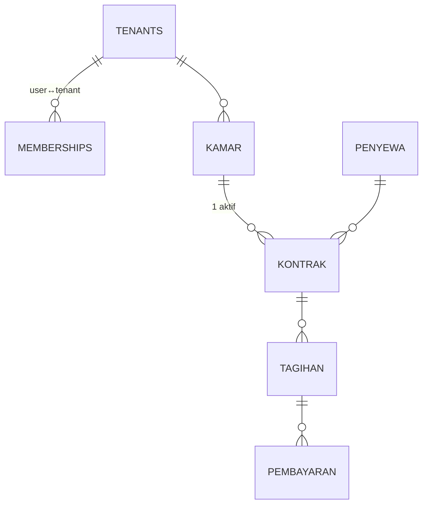

# Data Model

Skema PostgreSQL (Supabase). **Multi-tenant (SaaS)**: setiap owner punya tenant sendiri; semua data milik tenant. Isolasi ditegakkan RLS.

## `tenants` — unit data per owner
| Kolom | Tipe | Catatan |
|---|---|---|
| id | pk | |
| nama | varchar | Nama kos/tenant |
| created_at | timestamptz | Default now() |

## `memberships` — hubung user ↔ tenant + peran
| Kolom | Tipe | Catatan |
|---|---|---|
| user_id | uuid | fk→auth.users; bagian dari PK |
| tenant_id | uuid | fk→tenants; bagian dari PK |
| role | enum | `owner` \| `admin` |
| created_at | timestamptz | |

- PK `(user_id, tenant_id)`.
- `owner`: kelola anggota + pengaturan. `admin`: operasional harian (kamar, penyewa, kontrak, tagihan).

## Tabel bisnis
Semua tabel data membawa **`tenant_id`** (fk→tenants):
`kamar`, `penyewa`, `kontrak`, `tagihan`, `pembayaran`.

### `kamar`
| Kolom | Tipe | Catatan |
|---|---|---|
| id | pk | |
| tenant_id | uuid | fk→tenants |
| nama | varchar | Nomor/nama kamar, unik per tenant |
| tipe | enum | `regular` \| `vip` |
| kapasitas | int | Default 1 |
| harga_sewa | numeric | Rupiah/bulan |
| status | enum | `kosong` \| `dipesan` \| `terisi` \| `perbaikan` |

### `penyewa`
| Kolom | Tipe | Catatan |
|---|---|---|
| id | pk | |
| tenant_id | uuid | fk→tenants |
| nama | varchar | |
| no_hp | varchar | |
| email | varchar | nullable |
| nik | varchar | nullable, opsional |
| catatan | text | nullable |

### `kontrak`
| Kolom | Tipe | Catatan |
|---|---|---|
| id | pk | |
| tenant_id | uuid | fk→tenants |
| penyewa_id | fk→penyewa | |
| kamar_id | fk→kamar | |
| mulai | date | Tanggal check-in |
| berakhir | date | nullable; null = tanpa batas |
| sewa_bulanan | numeric | |
| deposit | numeric | Uang jaminan |
| jatuh_tempo | int | Tanggal; default 1 |
| masa_tenggang_hari | int | Default 0 (bisa 7) |
| denda_per_periode | numeric | Default 0 |
| aktif | bool | Satu-satunya aktif per kamar |

### `tagihan`
| Kolom | Tipe | Catatan |
|---|---|---|
| id | pk | |
| tenant_id | uuid | fk→tenants |
| kontrak_id | fk→kontrak | |
| periode | varchar | `YYYY-MM` |
| jumlah | numeric | Sewa + denda |
| jatuh_tempo | date | |
| status | enum | `belum_lunas` \| `sebagian` \| `lunas` |

### `pembayaran`
| Kolom | Tipe | Catatan |
|---|---|---|
| id | pk | |
| tenant_id | uuid | fk→tenants |
| tagihan_id | fk→tagihan | |
| tanggal | date | |
| jumlah | numeric | >0 |
| metode | enum | `tunai` \| `transfer` |
| catatan | text | nullable |

## Relasi

## Keamanan (RLS)
- **Tabel bisnis**: policy `tenant_id IN (SELECT tenant_id FROM memberships WHERE user_id = auth.uid())`.
- **`memberships`**: anggota bisa membaca membership tenant-nya; hanya `owner` boleh insert/delete (kelola admin). Update role hanya owner.
- **`tenants`**: dapat dibaca user yang jadi anggota tenant itu.
- **Bootstrap**: user pertama → buat tenant + row membership role `owner`; `admin` ditambah oleh owner.
- `tenant_id` di tabel bisnis: default dari tenant milik user; tidak bisa diubah ke tenant lain.

## Catatan integritas
- `kontrak.aktif` + **partial unique index** pada `(kamar_id, tenant_id) WHERE aktif` → invariant 1-kontrak-aktif per tenant.
- `tagihan` unik pada `(kontrak_id, periode)`.
- Status `kamar` dipertahankan sinkron via logika aplikasi saat buka/tutup kontrak.
