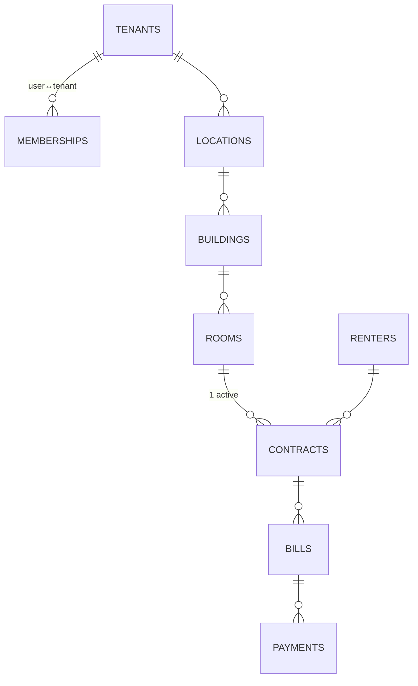

# Data Model

PostgreSQL schema (Supabase). **Multi-tenant (SaaS)**: each owner has their own tenant; all data belongs to a tenant. Isolation is enforced via RLS.

## `tenants` — data unit per owner
| Column | Type | Notes |
|---|---|---|
| id | pk | |
| name | varchar | Boarding house/tenant name |
| created_at | timestamptz | Default now() |

## `memberships` — user ↔ tenant link + role
| Column | Type | Notes |
|---|---|---|
| user_id | uuid | fk→auth.users; part of PK |
| tenant_id | uuid | fk→tenants; part of PK |
| role | enum | `owner` \| `admin` |
| created_at | timestamptz | |

- PK `(user_id, tenant_id)`.
- `owner`: manages members + settings. `admin`: daily operations (rooms, renters, contracts, bills).

## Business tables
All data tables carry **`tenant_id`** (fk→tenants): `locations`, `buildings`, `rooms`, `renters`, `contracts`, `bills`, `payments`.

### `locations`
| Column | Type | Notes |
|---|---|---|
| id | pk | |
| tenant_id | uuid | fk→tenants |
| name | varchar | Location/property name; unique per tenant |

### `buildings`
| Column | Type | Notes |
|---|---|---|
| id | pk | |
| tenant_id | uuid | fk→tenants |
| location_id | uuid | fk→locations |
| name | varchar | Building name within location; unique per location |

### `rooms`
| Column | Type | Notes |
|---|---|---|
| id | pk | |
| tenant_id | uuid | fk→tenants |
| name | varchar | Room number/name, unique per tenant+building |
| building_id | uuid | fk→buildings; room name unique per building |
| type | enum | `regular` \| `vip` |
| capacity | int | Default 1 |
| monthly_rent | numeric | IDR/month |
| status | enum | `available` \| `reserved` \| `occupied` \| `maintenance` |

### `renters`
| Column | Type | Notes |
|---|---|---|
| id | pk | |
| tenant_id | uuid | fk→tenants |
| name | varchar | |
| phone | varchar | |
| nik | varchar | nullable, optional |
| notes | text | nullable |

### `contracts`
| Column | Type | Notes |
|---|---|---|
| id | pk | |
| tenant_id | uuid | fk→tenants |
| renter_id | fk→renters | |
| room_id | fk→rooms | |
| start_date | date | Check-in date |
| end_date | date | nullable; null = indefinite |
| monthly_rent | numeric | |
| deposit | numeric | Security deposit |
| due_day | int | Day of month; default 1 |
| grace_days | int | Default 0 (can be 7) |
| late_fee_per_period | numeric | Default 0 |
| active | bool | The single active one per room |

### `bills`
| Column | Type | Notes |
|---|---|---|
| id | pk | |
| tenant_id | uuid | fk→tenants |
| contract_id | fk→contracts | |
| period | varchar | `YYYY-MM` |
| amount | numeric | Rent + late fee |
| due_date | date | |
| status | enum | `unpaid` \| `partial` \| `paid` |

### `payments`
| Column | Type | Notes |
|---|---|---|
| id | pk | |
| tenant_id | uuid | fk→tenants |
| bill_id | fk→bills | |
| date | date | |
| amount | numeric | >0 |
| method | enum | `cash` \| `transfer` |
| notes | text | nullable |

## Relations

## Security (RLS)
- **Business tables**: policy `tenant_id IN (SELECT tenant_id FROM memberships WHERE user_id = auth.uid())`.
- **`memberships`**: members can read their tenant's memberships; only `owner` may insert/delete (manage admins). Role updates owner-only.
- **`tenants`**: readable by users who are members.
- **Bootstrap**: first user → create tenant + membership row with role `owner`; `admin` added by owner.
- `tenant_id` on business tables: defaults from the user's tenant; cannot be changed to another tenant.
- `locations`/`buildings` follow the same membership policy as business tables.

## Integrity notes
- `contracts.active` + **partial unique index** on `(room_id, tenant_id) WHERE active` → guarantees the 1-active-contract invariant per tenant.
- `bills` unique on `(contract_id, period)`.
- Room `status` kept in sync via application logic when opening/closing contracts.
- Hierarchy FK chain enforces `location` > `building` > `room` (unique `(tenant_id,name)` / `(location_id,name)` / `(building_id,name)`); one tenant may hold multiple locations.
- Payment cap: `record_payment` rejects any payment that would push the sum of payments on a bill above the bill amount (overpayment exception) — enforced both per payment and across the cumulative installments.
